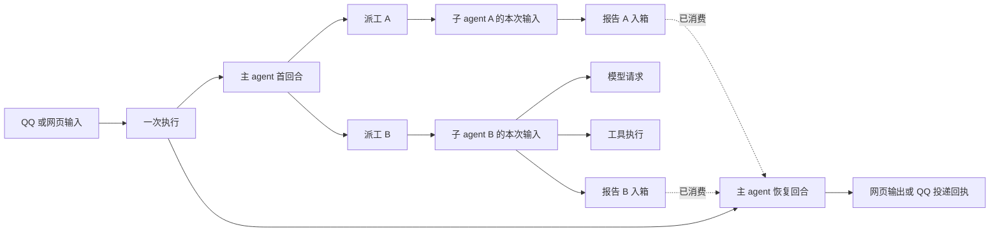

# Agent 执行链路与可观测性设计

**设计提案，尚未接入运行时。** 本文以仓库锁定的 Pi 1.6.0、Cloudflare Workers / Durable Objects（DO）和现有管理台为基线。

建议把管理台的排障入口放在**一次输入触发的执行**上。打开一条 QQ 消息，应能看到它等了多久、主 agent 把哪项任务交给谁、每个子 agent 实际调用了哪些模型和工具、哪些结果被主 agent 采用，以及 QQ 最终返回了什么回执。运营概览、单次执行和原始证据分别沿用合适的数据源。第一版可完全运行在已有 Workers 和 DO 上。

## 1. 打开一次执行，会看到什么

从会话消息或请求详情点「查看执行链路」。页首显示入口、执行状态、首条可见输出耗时、最终投递状态和采集完整度。左侧是主 agent、派工、子 agent、模型和工具的树，右侧共用一条时间轴。点节点打开已有的模型请求、工具执行或投递详情。默认折叠 Pi 内部阶段，切到「运行时细节」才显示 checkpoint、重试和恢复。

以下是假设的时序，用于说明用户看到的结果。A、B 并行，主 agent 在收齐报告后回复。

| 相对时间 | 执行树中的节点 | 操作者看到的证据 |
| --- | --- | --- |
| 0–1 s | QQ 入站 → 主 agent | 已入队、开始处理、首轮模型决定派工 |
| 1–3 s | ├ 子 agent A | 模型请求、工具完成、报告 A 入箱 |
| 1–6 s | ├ 子 agent B | 模型请求、设备工具等待、报告 B 入箱 |
| 6–8 s | └ 主 agent 汇总 → QQ | 恢复回合消费 A、B 的报告，生成回复，Bridge 收到成功回执 |

用户等了 8 秒。B 的报告比 A 晚 3 秒，且汇总确实依赖 B，可以沿这条依赖回查设备工具。若只有时间重叠、没有消费报告的证据，界面只画并行区间，等待原因显示「未知」。若主 agent 在 2 秒时已经回复，首条输出就记 2 秒，后来完成的后台分支仍可展开。运行中显示最近一次更新。数据过期、未采样、通道结果未知分别提示，允许查看还在保留期的证据。

缓存问题也从这一页查。例如按子 agent 展开「首次派工」与「后续模型调用」，逐笔查看模型、输入量、读缓存量、可比的上下文构成和测量覆盖率。供应商只返回命中 token 数时，页面只能说明命中了多少。具体哪个字段打断了前缀，需要同模型、同输入条件的受控对照。

## 2. 已经有什么，缺口在哪里

| 已有信号 | 事实来源 | 在新视图中的用途 |
| --- | --- | --- |
| 模型请求、用量与上下文 | `captureModels` → `RequestsDO("main")`，已有请求详情和上下文趋势 | 每次被采集调用的状态、用量、耗时、详情入口。保留这一处计量 |
| 回合内工具与耗时 | Harness 工具钩子、`callId/parentCallId`、`RequestBinding`、`TurnTiming`、现有 `/admin/threads/:key/trace` | 复用工具执行组及 QQ/Web 入队、首输出时间。现有时间线按回合查询 |
| 主子 agent 与会话状态 | 24 小时 agent 拓扑、父子任务状态、投影到 `RequestsDO("view:<scope>")` 的会话数据 | 拓扑回答「哪些 agent 活跃」，任务状态辅助实时展示。同一子 agent 可以先后接不同任务 |
| 入箱、回复及投递 | Agent 信封与重复入箱回执、父任务报告、网页输出行、QQ outgoing intent / Bridge 发送账本 | 区分接收入箱、消费、网页输出已保存、QQ 已发送和结果未知 |
| 系统健康、告警与日志 | `/admin/health`、`/admin/logs`、`/admin/alerts`、Cloudflare Workers Traces | 从组件异常跳到受影响执行。平台 trace 已配置 20% 头采样，与应用链路采样独立 |

缺口是**跨回合和跨 DO 的因果关系**。现有 `thread/actor`、`turnId/inputId/generation` 可以定位本地工作，单凭它们无法判定一个子 agent 的此次调用由哪次派工触发。Transcript 保留交互内容，`update_steps` 表达模型报告的计划进度。执行树以真实提交、调用和回执为依据，这两类内容留在已有会话界面。[管理台契约](ADMIN-CONSOLE.md) · [Agent 通信语义](AGENT-COMMUNICATION.md) · [请求绑定](../workers/src/requests/types.ts) · [平台配置](../workers/wrangler.jsonc)

## 3. 一次执行如何跨过主子 agent 和恢复边界

`executionId` 标识一次业务执行，取应用根 trace 的 W3C 格式 ID。会话窗口可以包含多次执行，一次执行也可以跨多个 turn、DO 唤醒和 Pi 原生 trace。运行区间用 span 表示，每个 span 至多有一个父节点。多输入、异步回报或跨执行的依赖用带原因的 link 表示。树用于导航，link 保留树表达不了的关系。[W3C Trace Context](https://www.w3.org/TR/trace-context/) · [OpenTelemetry Trace API](https://opentelemetry.io/docs/specs/otel/trace/api/)

| 边界 | 创建、继承与去重规则 |
| --- | --- |
| QQ、Web、定时或订阅事件首次受理 | 在已有入站去重边界生成并持久关联根 ID。重复提交取回原映射。定时按本次触发与目标，事件按来源投递与目标区分。由可信宿主产生 ID，外部消息、模型参数不能指定内部父节点 |
| 主 agent 派工或追加指令 | 在父侧派工记录与子侧接收的这一次信封间传递根 ID、派工 span、稳定操作 ID、目标代次和采样决定。映射落到此次子输入或 submission。同一子 agent 复用时，为新输入重新绑定 |
| 子 agent 报告、主 agent 恢复 | 分别记录报告生成、入箱和实际消费。派工与报告用稳定票据关联，重投只更新回执。主回合消费多份报告时建多条 link。只收到报告时不推断主 agent 等待过它 |
| 独立外部输入、steer、跨会话 `agent_send` | 独立触发分配新根。若多个输入被同一回合消费，实际执行只归一个主根，其他输入通过 link 指向它。主根以调度时持久化的归属为准。跨命名空间收方有自己的根，双方鉴权后才可查看对端 |
| alarm、重试和重放 | 从持久化的输入、task 或 intent 恢复上下文。实际重新执行建新 attempt。重复上报复用同一 span。Pi 回放已有工具结果只记 replay 事件。后台任务记录它所依赖的触发。无关联证据时单列 |
| 输出、静默、取消和重置 | 执行终态、用户可见结果、采集完整度独立记录。QQ 以 Bridge 账本为准，网页以输出持久化为准，静默完成单列。晚到回执可以更新投递状态。重置后旧报告保留原代次，不能挂到新回合 |

根 ID 使用 16 字节随机非零值，span ID 使用 8 字节随机非零值，均以小写十六进制存储。持久化关联随已有业务对象保存，旧记录允许缺省。跨 DO 内部信封只带版本、路由和受限的关联字段，不把权限、正文或通用 baggage 塞进传播数据。接收方仍按已有来源、边授权和 generation 验证，展示时再次校验访问范围。

### Pi 1.6.0 的接入点

主、子运行时分别在 `Harness.open(..., { telemetry })` 注入实现 Pi `TelemetryContext` 的轻量适配器。在调用 Harness 的边界把当前调用上下文传入。适配器实现可选的 `propagation.inject/extract`，供 Pi 持久化和恢复它自己的 carrier。应用侧另外保存 `executionId ↔ 本地输入/submission/task ↔ 派工` 映射。这样 isolate 重启后也能恢复执行归属，同一长寿命 Harness 可并发承接不同执行。[主运行时](../workers/src/thread/runtime.ts) · [子运行时](../workers/src/subagent/do.ts) · [Pi 锁定版本](../workers/package-lock.json)

- `pi.durable.submit` 在 input 分支从 Harness 的 telemetry 开 span，并向调用方添加 link。适配器给 Harness 提供无活动父节点的上下文，保留这段原生 trace 及其 link，按确切的 submission 映射挂到执行详情里。其他 submission 按 Pi 实际给出的父关系记录。
- `pi.durable.phase` 覆盖一次阶段处理及其决策提交，带 task、phase、attempt 和 resumed 等属性。阶段之间的 durable 等待用宿主受理、进入等待和恢复记录来解释。缺一端时显示「耗时未知」。
- `pi.ai.request`、`pi.ai.poll` 补充模型区间和轮询。当前 `captureModels` 在启动流之后才分配请求 ID，实施时需把分配前移，在本次调用的上下文传给适配器，已有请求继续使用同一个 ID。用模型返回的 tool call ID 加本地 actor/turn 绑定去关联工具，拒绝仅按时间或工具名配对。一个用户可见的模型节点可以展开多次 poll 或重试。只有上游暴露的物理尝试才可逐项显示。上下文压缩和后台调用要单测，缺少可靠绑定时单列。
- 适配器维护 Pi 原生 trace/span 的父子和 link。内置 recorder 的不透明 ID 不能直接填入 W3C 头。将来导出时使用适配器生成的标准 ID。独立原生根通过 OTel link 关联业务根。可参考 Cherry Studio 将 Pi 原生遥测接进应用观测层的实践，Workers 的持久化、权限和展示单独实现。[Cherry Studio 接入记录](https://github.com/CherryHQ/cherry-studio/blob/739799a18a43ad23a40f328a51639beaabc316da/.agents/notes/implemented/architecture/2026-11-09-pi-native-telemetry.zh.md)

Pi 内建的 recorder 适合核对单个 Harness 的原生 span。要回答跨 DO 的派工、报告消费和渠道送达，仍需要项目提供这些边。在管理台画这层业务视图可以直接复用权限、请求与工具详情。采用通用 trace 后端时，同一数据可从导出器提供，避免第一版先运维一套服务再重复实现业务关联。

## 4. 写入、存储与读取

**第一阶段先让链路可走通。** 在现有请求、工具、派工、报告、投递及回合投影的写入中附带可空的执行标识和稳定关联键，沿用原批次。主子执行同显所需的最小记录是根、派工、子任务受理、报告消费和输出回执。模型与工具只保存已有记录的引用。外部设备、MCP、沙箱或媒体操作先展示宿主发起和接到结果的边界，有可信远端确认时再展开内部阶段。

细节进入同一 DO binding 下按根会话命名的 `RequestsDO("trace:<rootScope>")`。这是一种**拟新增的实例角色**。保留 `main` 的用量聚合和 `view:` 的展示副本。创建或清理 `trace:` 时应显式按角色分派 schema 和 alarm，避免误用现有子 agent 视图的整库清理。单个高频会话会集中到一个分区，先按有界写入和实测排队控制，达到预算再评估按时间分区。[现有 RequestsDO 生命周期](../workers/src/requests/do.ts) · [已有投影与重试](../workers/src/requests/projection.ts)

| 拟新增的分区数据 | 必要字段与读法 |
| --- | --- |
| 执行索引 | `executionId, rootScope, generation, origin, startedAt, endedAt, runStatus, outputStatus, detailMode, completeness, droppedCount`。按本会话的开始时间和 ID 游标分页 |
| span | `(executionId, spanId)` 唯一，另存 `parentSpanId, actor, kind, startedAt, endedAt, status, attempt, sourceRevision, evidenceRef`。原生段另存 `nativeTraceId/nativeSpanId`。按执行及父节点索引，允许父节点晚到 |
| 因果 link | 源、目标（含作用域及执行 ID）和有限关系枚举，如派工、消费报告、由此恢复。唯一约束去重。普通页面只取本执行。明确点击且通过授权后才查目标作用域 |
| 增量修订 | 来源为每个实体分配单调修订号，分区对有变化的写入分配 `seq`。旧批次不得把终态覆盖为运行中。晚到回执作为独立实体更新。客户端按 `seq` 拉取，游标已被清理时刷新快照 |

**写入路径。** 关键关联随已有入站、派工、报告或 intent 持久化。读模型从这些可重放锚点构建。业务记录已存在而索引晚到时显示「同步中」。跨 DO 批次的目标分区由宿主按已验证的根会话推导。根索引与交接记录通过有界的本地待投递批次发送，接收方按实体 ID 和修订幂等确认。临时失败退避重试，到达配额允许丢观测并标记不完整。Pi 细节可以先在内存合并，按批交给 `ctx.waitUntil()`。isolate 退出时可能丢失尾批。只对已有宿主终态与预期回执作核对，无法量化的丢失标「完整度未知」。

**业务隔离。** 遥测写错、序列化失败或目标 DO 暂时不可用时，业务继续。关联字段随原写入一起保存，额外的索引、队列及导出失败均不得回滚业务结果。线程和子 agent 的 `alarm()` 第一行保留 `this.modelAlarm.dispatch()`。观测不得在派发前 await、查询存储或初始化 exporter。不要把高频 span 写进现有展示投影监听的业务表，以免每次写都调度投影。观测专用写入用独立的原始存储访问和明确的同步触发。[模型 alarm](../workers/src/models/alarm.ts) · [主线程](../workers/src/thread.ts)

**读取路径。** 在既有鉴权下新增 `GET /admin/threads/:key/executions`、`GET /admin/threads/:key/executions/:id` 及 `/spans?afterSeq=…&limit=…`。列表给摘要，详情给根、计数、最新修订及完整度，span 接口有分页和字节上限。历史与实时均读观测分区和已有只读副本，不唤醒执行 DO。运行中沿用管理台可见页面的增量轮询，结束后停止常规轮询，等待中的投递可以刷新。全局请求列表随既有摘要返回目标根会话和执行 ID，可直接跳转，无需扫描分区。点选时才读取对应模型或工具详情，避免每个节点一次 RPC。老回合只有现成证据时沿用旧时间线并标注「历史数据缺少派工关联」。

各 DO 记录本地起止时间，同一次调用的耗时优先取本地单调时钟。跨 DO 的时间轴按墙钟近似对齐，排序和依赖以持久事件为准。出现时钟倒序或缺失等待边时，界面标记时间不确定，保留原始测点。

## 5. 总览、指标和告警

管理台保留三个入口。**总览**回答哪些会话或组件在退化。**执行链路**回答一次输入卡在哪里。**请求与工具详情**回答该次调用实际传入及返回了什么。告警带时间窗口、影响数和有权限的执行样例。运行日志可以带可空的 `executionId/spanId`。排查从一个异常能回到一次执行，也能从一次执行回到同期总体表现。

| 问题 | 指标与分母 | 如何下钻 |
| --- | --- | --- |
| 用户多久看到回应？ | 按 QQ/Web 分开看从受理前的入站时间到首条确认输出的 p50/p95，分母为有确认输出的输入。同时列出静默、待投递、未知、失败和样本数 | 打开慢执行看入队、派工、报告和投递。总执行耗时另列 |
| 是模型变慢，还是在等调度？ | 按 provider/model/purpose 看已结束请求耗时、已有 `ttftMs`（首个流事件）、`alarmWaitMs` 的分布及缺失数 | 定位具体请求，区分宿主排队、首事件与生成结束 |
| 哪个子任务命中缓存少、成本高？ | 缓存命中率为有缓存读数的 `ΣcacheRead / ΣinputTokens`。同时显示可测请求数/总请求数。价格、用量未知保留缺失。按执行角色、模型及首次/续轮拆分 | 从低命中分组打开现有上下文详情。一次执行按去重 `requestId` 汇总，列表标明计量覆盖度 |
| 任务交出去了，为什么没有下文？ | 分别计数已派工、已入箱、已产出报告、被父侧消费。对需要报告且已过约定期限的任务统计超时率。展示仍在途和取消数 | 跳到派工票据、最后确认的交接点以及是否发生恢复 |
| 消息是否送到？ | QQ 以唯一 delivery 归并回执，分别计已确认发送、明确失败、未知及在途。网页单列已保存输出 | 看 Bridge 账本和对应 intent，未知回执进入已有核对流程 |
| 平台或观测本身是否退化？ | 组件健康、设备连接、模型出口错误、工具错误率，以及观测批次延迟、积压、已知丢弃、无绑定比例 | 组件故障看健康与日志。模型或工具错误回到对应执行。索引落后在页面显示数据截至时间 |

全站指标从独立于 trace 采样的业务摘要或预聚合读取，展示统计窗口与覆盖率。采样明细只作案例。指标维度限入口、组件、模型、用途、结果等有限值。执行 ID、会话 ID、工具参数和错误原文只在授权的查询中处理。第一轮先建立同流量时段的基线。对「有流量且回复延迟持续升高」「目标通道连续出现未知回执」「投影持续积压」设置最小样本、连续窗口、恢复条件和同组件去重，再接现有告警页。缓存波动先作诊断，避免一次冷启动就触发告警。[现有指标口径](../workers/src/requests/capture.ts) · [聚合与保留](../workers/src/requests/do.ts)

## 6. 采样、成本与权限

以下数字是首轮压测和灰度的**建议预算**，实际占用、读写费用和阈值要在目标 Cloudflare 环境测量。

| 项目 | 首版策略 |
| --- | --- |
| 采样 | 默认保留已接入执行的根摘要和交接证据。Pi 细节先在 owner 测试会话全采，再试按根哈希采 10%，同一执行的子 agent 继承决定。未采样的失败可保留错误码及既有请求证据，不能事后重建阶段明细 |
| 写入与内存 | 每个发送方至多一批在途。每批最多 64 条或 64 KiB（先到为准），生产者内存缓冲限 256 KiB，每执行细节先限 512 个 span / 512 KiB。达到上限先丢细粒度事件，预留根、交接与终态空间。并行子任务共享接收端的执行额度 |
| 保留 | 建议执行摘要至多 30 天、Pi span 至多 7 天。初始每分区细节 8 MiB，达到容量先清理最老细节，摘要与待发送队列也设独立条数和字节上限。按索引分批清理，容量可能使实际窗口更短。已有请求元数据上限 20,000 条，正文为 7 天 / 32 MiB 共享预算，链接可先于链路失效 |
| 读取 | 一页先限 100 个节点或 128 KiB。按树枝展开、分页拉取，不通过 WebSocket 广播完整 trace、正文或附件。压测覆盖宽树和长任务，单 DO 以 128 MiB 内存为硬边界 |
| 数据最小化 | span 只收白名单属性，如阶段、耗时、枚举错误码、内部记录引用。禁止原始提示词、工具参数/结果、Authorization、可下载 URL 和附件内容。先筛选脱敏再截断。详情沿用原端点的授权与保留。用户标识不进入导出属性 |
| 权限与关停 | 查询按已认证会话作用域校验，trace ID 不能作为凭证。管理台与模型可调用的 `ops_*` 分开。后者保留 owner 限制、跨会话仅摘要、过滤当前回合和输出限额。分别设置关闭 Pi 明细、停止导出、关闭新增采集的开关。必要时回到既有时间线 |

容量按「参与会话数 × 每会话保留量」和「采样执行数 × 平均 span 数」估算。例如，日均 1,000 次执行、采样 10%、每次 40 个 span、编码后均值 400 B，约为 **1.6 MB/日** 的明细载荷。SQLite 页、索引、摘要、重复传输和查询另计。重点实测每次执行增加的 DO 写行、批次 RPC、CPU、活动时长和 p95，不用载荷体积直接推断账单。[现有保留策略](../workers/src/requests/retention.ts)

## 7. 交付顺序和验收

| 阶段 | 可交付结果 | 放量条件 |
| --- | --- | --- |
| ① 链路骨架 + 第一张可用的执行图 | 从一条 QQ 或 Web 输入点进树，看到主 agent、两个并行子 agent、已有模型与工具、报告和最终输出。引入执行关联、按根分区的最小读模型和分页接口 | 重复信封、子 agent 复用、跨代旧报告、未知投递、未升级旧记录各有独立用例。打开页面不唤醒执行 DO，已有请求数和 token 总量与基线一致 |
| ② Pi 原生阶段与恢复 | 在 owner 测试会话接入主子 Harness，展开 phase、等待、attempt、poll 和 replay。可从慢节点回到原始请求或工具 | 在 workerd 中制造模型重试、工具完成后重启、投递批次重发及父节点晚到。验证重启仍可关联、重复数据不重复计量、观测故障时正常响应。校验管理端与 agent 各自的访问范围 |
| ③ 指标、告警与灰度 | 将慢执行、派工超时、缓存与投递异常连接到总览。在有代表性的并发和工具流量下逐步开放 | 对比关闭/开启时的同负载 p95、DO 每次执行读写与峰值内存。首轮以业务 p95 增幅不超过 5% 为候选门槛，并给低流量样本留置信区间。验证超额丢明细、滚动清理、告警恢复和关闭开关 |
| ④ 可选标准导出 | 当需要跨系统检索时，从允许导出的已脱敏批次生成 OTLP，连接现有 Collector 或兼容后端 | 用本地接收器验证父子、跨 trace link、状态、时钟与采样标志。服务端不可用时丢弃或有限重试。Langfuse、外部账号和常驻 Collector 均为按需选择 |

首批可重复的验收场景包括两个子 agent 并行、同一子 agent 接第二个任务、父侧先回复而子任务后结束、跨会话通信、取消后收到旧回执。逐项核对「图上的每条边来自哪份持久证据」「每个可点记录是否能被当前角色读取」「同一调用是否只计一次」。在本地 workerd 验证后，再在获准的目标环境验证真实模型、QQ 回执、延迟与费用。
