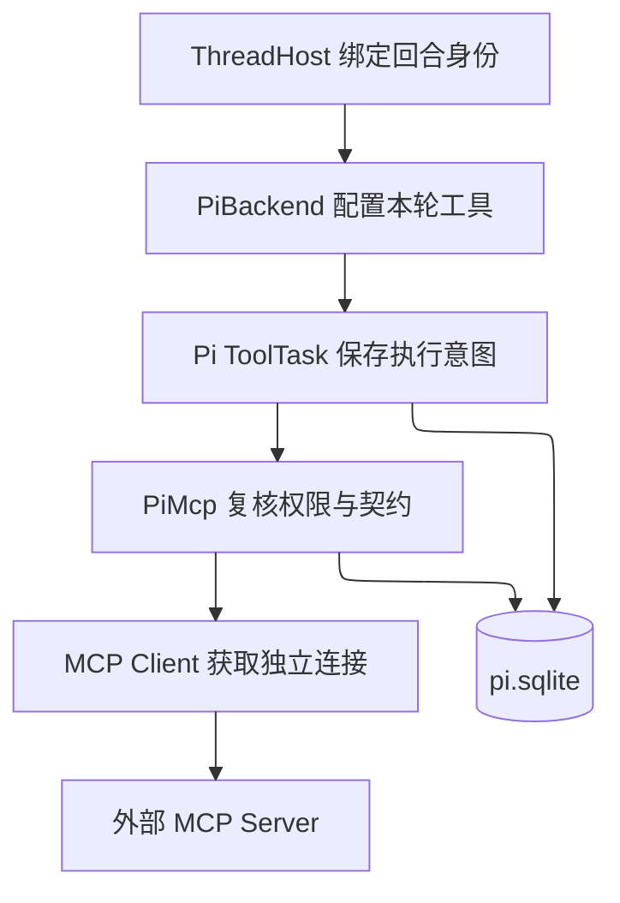

# Pi MCP 接入设计

状态：首版已实现，完成本地协议、恢复测试及实际局域网服务接入验证。更新：2026-10-25（移除 stdio 传输）。设计基线：cs-agent `7372dcf`、pi-durable `1.3.0` 与 MCP TypeScript SDK `1.32.1`。启用步骤见 [使用说明](PI-MCP.md)。

## 1. 设计结论

在 Pi 后端内部增加 `PiMcp` 模块，把 MCP Server 提供的每个工具包装成一个带原始参数 schema 的 Pi 原生工具。连接、目录、凭据、权限与结果转换由这个模块管理；调用执行、检查点和恢复终态继续交给 Pi ToolTask。

首版支持 **Streamable HTTP、静态凭据、tools 发现与调用、目录刷新、会话隔离、取消、故障恢复和可观测性**。不实现 stdio 与 OAuth。所有 MCP 工具固定为 `replay: "unsafe"`，不新增调用账本或第二套任务状态机。

权限首版限定为 **owner 私聊主会话**，子 agent、普通私聊和群聊均不自动获得外部账号能力。后续授权与委派的接口约束见第 13 节。这是首版范围选择，不是 Pi 或 MCP 的技术限制。

调用关系：



图中 PiMcp 写入的是目录定义；ToolTask 写入的是调用检查点和结果。Client、socket、HTTP session 和浏览器状态不持久化。该图仅表达主要调用关系，具体模块归属见第 3 节。

## 2. 能力范围

| 能力 | 本设计首版行为 |
| --- | --- |
| 初始化与版本协商 | 使用已锁定版本的 SDK；协商不兼容时停止该连接 |
| stdio | 不支持；配置中 `kind: "stdio"` 按无效配置拒绝 |
| Streamable HTTP | 支持 JSON 和 SSE 响应；SSE 是此传输的一部分 |
| 认证 | 无认证、固定 Bearer/API key/请求头 |
| tools | 完整分页发现、白名单筛选、调用、目录变更通知 |
| 结果 | text、image、structuredContent；其他内容明确降级 |
| 取消与进度 | 传播取消信号；进度有界接收，不能作为成功依据 |
| OAuth | 不实现授权跳转、动态注册、回调、刷新 token，也不安装 SDK authProvider |
| 旧 HTTP+SSE transport | 不支持，不自动降级；与上面的 HTTP SSE 响应区分 |
| resources / prompts | 不实现 list/read/get/subscribe，结果内嵌资源按第 10 节处理 |
| sampling / elicitation / roots / MCP tasks | 不声明这些客户端能力；收到相关请求明确返回不支持 |
| 热重载管理员配置 | 首版修改配置后重启；协议目录可在线刷新 |
| 自动重放、跨进程调度 | 不支持；单进程独占现有 Pi 存储 |

工具分页、变更通知、结果结构依据 [MCP tools 规范](https://modelcontextprotocol.io/specification/2025-06-18/server/tools)；传输边界依据 [MCP transports 规范](https://modelcontextprotocol.io/specification/2025-06-18/basic/transports)。本设计固定兼容基线，不把某个协议日期称为最新版。

## 3. 放在项目哪里

现有 `src/mcp/` 是向 Codex 提供 im/qq_context 的 **MCP Server** 入口。新增模块属于 agent 内部的 **MCP Client**，不能从 agent 反向导入 `src/mcp/`。保持现有 `shared → … → agent → obs → mcp → main` 分层约束。

| 落点 | 职责与改动 |
| --- | --- |
| `src/agent/pi-mcp/index.ts` | 唯一宿主入口，拥有生命周期、Registry 注册与会话选择；暴露 `attach/configure/beginShutdown/close` |
| `src/agent/pi-mcp/config.ts` | 严格解析配置、默认值、限额和秘密引用；从 schema 推导类型 |
| `src/agent/pi-mcp/catalog.ts` | 不可变目录、命名、schema 兼容验证、持久化与版本选择 |
| `src/agent/pi-mcp/connection.ts` | 单连接 SDK Client、分页与初始化；队列和连接隔离在 index.ts 中管理 |
| `src/agent/pi-mcp/transport-http.ts` | HTTP JSON/SSE 原始消息限额、拒绝重定向与跨源 |
| `src/agent/pi-mcp/schema.ts` | 严格 draft-07 子集验证与编译 |
| `src/agent/pi-mcp/result.ts` | MCP 结果验证、Pi 输出转换、内容预算与错误分类；纯边界函数 |
| `src/config.ts` | 只增加 `PI_MCP_CONFIG` 路径，不导入 agent 实现 |
| `src/main.ts` | 读取配置与环境秘密，向 PiBackend 注入经过验证的配置和秘密解析函数 |
| `src/agent/backends/pi.ts` | 在暂停调度时 attach；每轮 configure；先关闭 Pi Harness 再关闭 MCP |
| `src/agent/pi-tools/index.ts` | 为 MCP 工具增加独立审计分支，避免现有通用 hook 记录完整输入和输出 |
| `src/agent/pi-tools/subagent.ts` | 从复制给子会话的 tools/callable 中排除 MCP 工具；执行端仍复核 child 身份 |

这是模块地图，不要求为每个概念新建 class。只有 PiMcp 拥有可变目录与连接生命周期，其他文件提供其私有实现，外部不能取得 SDK Client。

调用方形状如下，生产类型索引见 [interfaces.ts](design/pi-mcp/interfaces.ts)：

```ts
// PiBackend.open：Harness.open 后，但还没有 resume。
const mcp = await PiMcp.attach({
  registry, harness, config, secrets, owners: currentOwners,
  binding: id => backend.binding(id),
});

// configureTools：已有会话、新会话及获准的唤醒回合都经过这里。
await mcp.configure({ conversation: conv, turn: currentTurn }, context);

// 现有 beginShutdown / close 内的接入顺序。
mcp.beginShutdown();
await harness.close(context);
await mcp.close();
```

这是调用形状。`backend.binding` 必须在第一次使用前完成实例绑定，不能在构造期间触发尚未赋值的 backend。

## 4. 配置契约：不依赖 OAuth 或新密钥平台

`PI_MCP_CONFIG` 未设置时不开启新 MCP 调用。设置后读取管理员维护的 UTF-8 JSON 文件；不从聊天消息、模型参数或工作区生成物加载服务配置。

完整示例保存在 [config.example.json](design/pi-mcp/config.example.json)。以下是其核心配置；域名是占位示例。

```json
{
  "version": 1,
  "enabled": true,
  "servers": [
    {
      "id": "docs",
      "enabled": true,
      "transport": {
        "kind": "streamable-http",
        "url": "https://mcp.example.com/mcp",
        "headers": {},
        "secretHeaders": { "Authorization": "DOCS_AUTH_HEADER" },
        "allowLoopbackHttp": false
      },
      "credential": { "kind": "external-account", "accountId": "owner-docs", "revision": "1" },
      "tools": { "allow": ["search", "fetch_document"] },
      "access": { "kind": "owner-private", "allowScheduled": false, "allowWake": false },
      "replay": "unsafe"
    }
  ]
}
```

配置语义：

1. `secretHeaders` 的值是宿主环境变量名，解析函数仅读取配置引用的变量。示例 `DOCS_AUTH_HEADER` 存完整的 `Bearer …` 值；API key 同理。秘密值不写入配置快照、工具参数、目录或审计。
2. `credential.accountId` 是管理员声明的逻辑账号，`revision` 是凭据/账号轮换版本。替换账号、token 或改变权限时递增版本并重启；首版不在进程中自动刷新环境秘密。该字段不验证第三方账号归属，归属由管理员配置保证。
3. `tools.allow` 是远端原名的精确白名单；空列表表示无工具，不支持隐式全部放行。发现新工具不会自动增加权限。
4. `owner-private` 同时要求真实 owner 身份、`threadKey === "owner"`、主会话。owner 在群中说话也不满足；未知身份不得回退成 owner。
5. 定时和唤醒默认拒绝。启用对应选项后仍要求宿主可验证的原 owner 身份、当前 owner 配置和 owner 私聊范围全部匹配。继承定时身份的 wake 必须同时满足两个开关。不能仅按线程名信任唤醒。
6. 首版子 agent 始终拒绝，无配置开关可绕过。扩展委派必须先完成第 13 节的身份快照与工具过滤。
7. HTTP 默认 HTTPS；loopback 需显式设置 `allowLoopbackHttp`，局域网 RFC1918 IPv4 字面地址需显式设置 `allowPrivateNetworkHttp`。私网开关不允许公网、链路本地地址或域名。禁止 URL 内嵌密码；固定 origin，不跟随重定向，不能把认证头发送到其他来源。禁止覆盖 SDK 管理的协议、session、Host、Content-Length 等 header。敏感 header 只能用秘密引用。
8. Zod 严格拒绝未知字段、重复 id、非法限额、stdio 传输、`replay: safe` 和 OAuth 配置。全局结构错误时整个 MCP 禁用并明确告警；单服务缺秘密/连不上只降级该服务。本地 Pi 工具继续工作，不静默改用别的账号。文件未设置、禁用或损坏时仍恢复已有目录以结算旧任务，但不给新回合选择工具。

配置文件、秘密注入和服务发布由运维管理；首版不增加聊天内的“安装 MCP”或“修改命令”入口。

## 5. 身份与会话隔离

模型参数只包含远端业务参数。`serverId`、凭据、threadKey、actor、conversationId 和授权来源均来自宿主与已安装工具定义，模型不能覆盖。

目录发现前先授权；配置选择使用既有 `runRights(turn, currentOwners())`，执行时重新调用 `PiBackend.binding(conversationId)`。owners 读取函数由宿主注入，不在 MCP 模块复制身份推导。这能覆盖 owner 配置变化、回合切换、未知 wake 和子会话。schema 隐藏只是减少误用，真正边界是发请求前的复核；排队后、拿到连接后再检查一次取消状态与身份。

每个连接的键为：

`serverId + configDigest + credentialRef/revision + verifiedPrincipal + authorizationScope + PiConversationId`

同键只有一个初始化 Promise、一个 Client 和一个串行调用队列。不同会话、重置后的新会话、账号或身份不得共用有状态客户端。即使两条会话使用同一账号，也不共用浏览器标签页或远端工作区。HTTP sessionId 只是协议状态，不是用户身份。

目录按实际授权作用域发现，不假设不同账号、不同会话返回相同工具。缓存命中也不能跳过权限检查；不在共享 Client 上设置全局“当前用户”。

首版不修改现有 send/schedule grants。新增 MCP 不赋予 QQ 发送权限，也不替换原有 send_message → SendService → Outbox 路径。

## 6. 工具目录、schema 与稳定命名

每个远端工具契约对应一个版本化 extension。全局 Registry 保存定义；会话只选择本轮可用的 MCP extensions，同时保留原有 coding/IM/schedule 扩展。同一契约复用 extension，纯描述更新可以替换展示定义。

原生名称格式为 `mcp_<serverSlug>_<toolSlug>_<hash12>`：ASCII，最长 64 字符。slug 只用于阅读，完整 SHA-256 才是身份；短 hash 冲突必须拒绝发布。catalogDigest 仍标识整个目录快照；v2 工具 hash 独立依据服务器 id、配置与账号引用版本、权限范围、远端工具名及输入/输出 schema。排除目录摘要、工具描述及 schema 节点中的 description/title/$comment；规范化只遍历 schema 节点，保留同名业务属性、const/default/enum 数据。其他工具变化不再导致当前工具改名。摘要不包含密钥明文。

发现流程：

1. 握手确认 tools capability，按 `nextCursor` 读完整目录，检查重复 cursor、重复工具名、页数和大小。
2. 所有页成功后才形成候选快照；半截目录不得替换旧目录。输出校验器归本模块所有，不依赖 SDK 单页缓存覆盖后的状态。
3. 先白名单过滤，再验证要暴露的 schema。单个 schema 无法支持则隔离该工具、记录原因；不能把 schema 静默降为任意对象。
4. 持久提交完整目录版本，再安装 Registry 定义，最后更新会话选择。后两步可重复；崩溃后根据已提交目录重新安装，不要求 Registry 与数据库形成事务。

schema 进入模块时是 `unknown`。首版支持经过契约测试的 draft-07 兼容子集、根 object 和文档内 `$ref`；明确拒绝外部引用、循环引用及不支持的方言/关键字。不删校验条件来“修复”schema，不手工重写成 TypeBox，不用强制类型断言冒充已经验证。Pi 当前可以处理普通 JSON Schema，但实际支持范围由编译和样例验证确定。

适配器在发出请求前再次验证 Pi 最终传入的参数。Pi 自身可能执行参数修复/类型转换，因此本设计不承诺输入逐字节原样转发；不会额外填充默认值、替换调用目标或注入未定义业务字段。

## 7. 目录刷新与配置变化

`notifications/tools/list_changed` 只把对应目录标为 dirty，合并短时间内重复通知。刷新成功后发布新不可变版本；下一次模型请求使用新选择，已经发起的请求继续按原契约处理返回值。无通知或丢失通知时，连接重建与五分钟 TTL 到期触发全量重查。

旧契约不会被新契约同名覆盖。旧调用尚未发送时，包装器检查 dirty 状态与目标工具当前契约：工具已删除、契约已变、服务配置目标已变时返回 `tool_retired`；无关工具与纯描述变化允许继续调用。刷新失败时保留旧目录用于历史解释；dirty 或过期目录不再发出新调用，返回有界的失败码（如 `protocol_error`、`catalog_limit`、`reconnect_backoff`）。调用审计记录实际检查的目录摘要。

owner 私聊中的 `mcp_refresh_tools` 提供显式刷新，只有已授权服务才参与。Pi 在工具任务创建前生成的 `tool_unavailable` 也需要恢复提示：beforeRequest 读取有界的持久化结果，核对结构化诊断、调用标识与当前权限后增强本次模型输入。只对 tool_unavailable/mcp_tool_retired 表示本次 not_started，不根据远端文本推断，不改变历史记录或此前未知结果，不转发旧写调用。

目录更新由 PiMcp 串行发布，会话配置沿用 PiBackend 按 threadKey 的串行边界。避免异步刷新直接写全局“当前会话”或重置非 MCP 工具。身份切换不能被“整轮固定目录”阻止，撤权优先于可见目录的稳定。

MCP tools/call 不携带可强制服务端校验的 schema 版本。客户端能够拒绝已经观察到的不兼容变更，但不能消除 list 与 call 之间的远端变更竞态。需要严格契约的服务应部署不可变版本端点；服务端返回参数错误时不盲重试。

管理员配置首版只在启动读取。所谓“撤服立即生效”是指重启后新调用立即拒绝，不承诺文件编辑后即时热撤销；动态 owner 身份仍每次复核。

## 8. 持久化与恢复

### 8.1 保存什么

在 `pi.sqlite` 中新增 session-scoped 的 `cs.pi.mcp.catalogs` 文档，version=1，由 PiMcp 单独写入。首版可以用一个有界的 revision map，减少索引与定义之间的同步状态；规模确有需要时再改 doc family，并提供迁移。

每版保存目录摘要、作用域摘要、服务 id、配置摘要、原始 schema、原名、描述和适配版本。配置摘要包含服务/账号引用版本；adapterVersion=1 按旧的整目录命名算法恢复，adapterVersion=2 按单工具契约恢复，不能用新算法重算旧名称。外部业务工具统一指定 `replay: unsafe`，本地目录刷新工具为 safe。不保存秘密值、HTTP sessionId 或 socket。会话的 extension 选择继续使用 Pi 自带配置文档，不复制一套选择状态。

ToolTask 检查点与结果继续由 Pi 保存。正常工具参数/有界结果会进入 Pi 对话历史，因此必须按现有会话历史的访问控制和备份规则管理；“审计不采正文”不代表数据库没有工具内容。

目录设总大小与版本数上限，按引用回收，不按年龄盲删。版本只在提供被引用的工具 extension 时保留，引用来自三处：任一会话 `pi.agent` 的 extension 选择（数组或 `add`）、非终态 `pi.tool` 任务所调工具名（模型调用从 assistant 条目按 callId 读取，嵌套调用取输入中的名称）、当前连接池持有及正在写入选择的目录。纯描述不同的 v2 版本共享 extension 名，先保留连接持有的版本，其余仅在提供尚未覆盖的引用时保留。

回收在启动恢复前执行一次；运行期仅在发布新版本将超限时执行，回收后仍超限则拒绝发布并降级受影响服务。任何引用无法证明（活任务的 `mcp_` 工具名找不到存储版本、读取失败）时整轮不删；当前限额下无法恢复的版本也原样保留。运行期回收只删持久记录，已安装的 Registry extension 留到进程结束。文档形状与版本不变。

### 8.2 启动顺序

1. 解析配置与秘密引用；构造 Registry，打开暂停调度的 Pi Harness。
2. 读取并校验历史目录，安装对应版本包装器；不需要先连接所有外部服务。
3. 完成现有 ThreadHost 回合身份恢复、事件观察和会话映射。
4. 按当前配置标记哪些目录可用于新调用；缺失/禁用服务的旧定义只用于拒绝和历史解释。
5. 由现有 `PiBackend.attach()` 调用 `harness.resume()`。首次实际使用再连接、发现和核对目录。

因此外部服务离线不会永久阻塞 Pi 启动。目录损坏只隔离对应定义；底层数据库自身损坏仍按现有存储错误处理，不伪装成正常启动。

### 8.3 崩溃与结果矩阵

| 崩溃/失败位置 | 恢复行为 | 是否自动再次 tools/call |
| --- | --- | --- |
| ToolTask 还在 `call` 阶段，未提交执行意图 | 重新解析工具、权限和参数；可进行首次执行 | 可以首次发送 |
| 已提交 `execute`，尚未真正发到服务端 | Pi 不能证明没有发送，按 interrupted 结算 | 否 |
| 服务端执行中，客户端断线或进程退出 | 结果未知，可能已产生副作用 | 否 |
| 服务端已成功，本地结果尚未提交 | 仍是结果未知 | 否 |
| Pi 已提交工具结果 | 使用持久结果继续后续任务 | 否 |
| 历史工具或服务被删除 | `call` 阶段 unavailable；`execute` 阶段 interrupted | 否 |
| schema/目标配置已变且调用尚未发送 | 包装器返回 tool_retired，要求重新获取工具 | 否 |

这是 pi-durable 当前 `ToolTask` 的保守语义：只有历史检查点与当前定义都标 safe 才会恢复执行。首版全部 unsafe，宁可中断一个实际上尚未发送的操作，也不猜测它一定没执行。

不声称 exactly-once。普通超时后模型仍可能创建一个新 callId 重复操作；本版保证的是 **适配器、SDK 包装层与 durable 恢复不自动重发**，不是跨业务语义去重。未知结果必须提示“可能已执行，先查询实际状态，不要自动重复”。若业务需要强制阻止新的相同写操作，应采用第 13 节的专用幂等适配或未知操作账本，不能仅靠文案宣称已解决。

## 9. 正常调用、故障与关闭

正常调用依次完成：真实绑定 → 当前授权 → 契约核对 → 队列额度 → 获取独立连接 → 再次检查身份与取消 → 单次 tools/call → 输出验证 → 返回 Pi 结果。网络调用不得发生在 SQLite 提交函数内。

| 结果类别 | 含义 | 给模型的处理方向 |
| --- | --- | --- |
| `not_started` | 绑定/权限/参数/连接准备失败，能够确认未 dispatch | 修正前置条件 |
| `outcome_unknown` | dispatch 后超时、断线、取消或无法确认结果 | 核对外部状态，勿自动重试 |
| `remote_error` | 收到合法 MCP 错误结果 | 保留远端 isError；错误不代表没有副作用 |
| `result_rejected` | 收到响应但 schema、大小或内容不满足契约 | 说明远端可能已完成，不为重新取结果重做操作 |
| `remote_state_lost` | 原远端会话/句柄不可恢复，另标明是否已经 dispatch | 显式重建工作状态；已发送的原操作仍按未知结果处理 |
| `ok` | 合法、有界结果 | 继续本轮 |

普通错误转换成有错误码的 Pi `isError`，避免进入外层通用 retry 路径。**Harness 关闭/任务中断的信号要继续向上抛出**，保留 Pi 检查点语义，不能转换为普通完成结果。

初始化失败后使用带抖动的重连退避，后续发现或调用可再次尝试连接；首版不在同一次调用里循环重试。tools/call 不因为重连、401、429、5xx、session 404 或 schema 错误而重发。401/403 不启动 OAuth，也不尝试另一账号。SDK 的自动 SSE 断点恢复已关闭，断流按当前调用预算结算；发送后的异常统一为 `outcome_unknown`，具体原因仅保留为有界审计码。

AbortSignal 传播到 SDK，并尽力发 MCP cancellation；本地等待有截止时间。取消不证明远端停止。迟到响应不得归到下一次调用，已经结算的调用不能被迟到消息重复提交。

关闭顺序必须保持现有 `shutdown.ts` 的约束：

1. `pi.beginShutdown()` 同时关闭 MCP 新准入、发现及后台刷新。
2. 关闭派发 Harness，防止 Pi 退出造成的等待错误被保存为派发失败。
3. 关闭 Pi Harness，让运行中的 ToolTask 按既有规则停止/保留检查点。
4. 最后限时关闭 MCP Client/transport；HTTP session 终止为 best effort。

`close()` 必须可重复；初始化中途失败也进入同一路径清理。

## 10. 内容转换与资源限额

| MCP 内容 | Pi 映射 |
| --- | --- |
| text | `output` 中的 text；超限明确标出截断与原始大小 |
| image | 检查 MIME、base64、解码大小和尺寸后成为 Pi image；不支持模型/格式则给省略诊断 |
| structuredContent + outputSchema | 独立校验后映射 `structuredOutput`，注册对应 `structuredOutputSchema`；同时提供模型可读的有界文本 |
| structuredContent 无 outputSchema | 仅提供有界 JSON 文本，不伪造 Pi 结构化契约 |
| embedded text resource | 带 URI 来源的资料文本，计入同一文本预算 |
| resource_link | 展示 URI、名称、MIME 等元信息，不自动访问 |
| audio / binary resource | 给出类型与省略说明，不灌入 base64、不假装已转写 |

Pi 模型主要读取 `output`，不能只保存 structuredContent。结构化数据不通过截断 JSON 来“满足”大小限制；超限时返回 result_rejected，不填写与 schema 不符的 structuredOutput。MCP `isError` 保留，不能把错误对象 stringify 后当成功结果。

远端描述、instructions、日志和结果均是不可信资料。远端 instructions 不直接拼入系统提示，结果中的指令不能修改权限、服务配置或安全策略。

建议初始限额如下。这些是工程起始值，用于限制连接数、内存和模型上下文；不是性能测量结论，实现时用边界测试验证。

| 项目 | 默认值 | 达限行为 |
| --- | --- | --- |
| 连接/初始化 | 10 秒 | 服务降级 |
| 单调用总预算 | 60 秒，含排队/连接，管理员最多配置 300 秒 | 按是否 dispatch 分类 |
| 连接数 / 单连接排队数 | 16 / 16 | 回收空闲连接或明确 busy，不逐出活跃调用 |
| 空闲连接 TTL / 目录 TTL | 各 5 分钟 | 空闲释放 / 下次使用先刷新 |
| 每服务目录 | 20 页、200 工具、2 MiB | 拒绝该候选快照 |
| 单工具 schema / 嵌套深度 | 输入输出合计 64 KiB / 64 层 | 隔离该工具 |
| 每会话暴露工具 | 64 个 MCP 工具；模型工具定义（名称、描述、输入 schema）总计 512 KiB | 明确配置过大，要求缩小白名单，不默默截断 |
| 参数 | 256 KiB | dispatch 前拒绝 |
| 单原始协议消息 | 12 MiB | 停止该消息/连接并按阶段分类 |
| 输出文本 / 结构化结果 | 32 KiB / 256 KiB | 文本标截断 / 结构化拒绝 |
| 图片 | 最多 2 张，每张 5 MiB，内容解码总量 8 MiB | 省略超额内容并提示 |
| 持久目录 | 最多 128 版、总计 32 MiB | 先按引用回收；仍超限则拒绝新版本并告警 |
| 关闭宽限 | 每连接 3 秒，总体 10 秒 | 放弃等待并释放连接，不无限阻塞 |

原始大小限制必须在 JSON 解析之前生效：HTTP 限制读取的 JSON/SSE event，同时约束缓冲区。仅在 `client.callTool()` 返回后检查不构成内存上限。SDK 没有可用钩子时实现小型受限 transport 包装器；不要访问 SDK 私有字段来假装已经限制。

协议进度不写正文日志。单条消息在解析前限量，连续进度不能重置总调用超时。

## 11. 审计与运维

复用现有 trace 和状态展示，只增加 MCP 分类。默认记录 serverId、工具原名/原生名、catalogDigest、conversation/task/callId、阶段、耗时、输入输出字节数、错误码、连接重建及截断次数。默认不记录参数正文、输出正文、认证头、秘密值或原始第三方错误堆栈。

**必须修改现有 `cs-pi` ToolTask hooks。** 当前非 builtin 路径会记录完整 `call.arguments` 与 `result`；仅在 PiMcp 内脱敏挡不住这条入口。hooks 根据已验证的 MCP 名称映射分支，只交付元数据；即使历史映射缺失，保留的 `mcp_` 命名空间也按不采正文处理。

unsafe 恢复直接进入 Pi 的 interrupted 终态，不经过 execute/afterTool。恢复中断指标由现有会话 entry/event observer 识别 MCP ToolResult 的终态补齐，按 taskId/结果 entryId 去重；不能只统计 afterTool。

服务状态至少包含：disabled、connecting、ready、degraded、auth_failed；附工具数、目录版本、最后成功时间、脱敏错误类别与连接数。告警关注持续不可用、unknown、目录/连接上限、连接关闭失败。面板只读展示，不增加能直接改命令或释放未知操作的普通聊天权限。

运维流程：维护配置和秘密 → 校验配置 → 重启 → 查看服务与目录状态 → owner 私聊运行指定的无副作用 smoke 工具。校验配置本身不得调用业务工具。回滚可以禁用服务并重启，保留历史目录与已提交结果；回滚不会撤销远端已经发生的操作。

## 12. 验证与落地顺序

测试使用本地可控 MCP fixture、真实 Registry/Harness 与临时 pi.sqlite，不依赖真实 QQ、付费模型或生产外部账号。

| 测试组 | 必须证明的行为 |
| --- | --- |
| 配置与认证 | Streamable HTTP，拒绝 stdio；无 OAuth provider；秘密缺失、非法 header/URL；401/403 不开启认证流程或换账号 |
| 发现与命名 | 全分页、重复 cursor/名称、半目录失败、短 hash 碰撞、同名跨服务；新工具不会突破白名单 |
| schema | 普通 JSON Schema、局部引用、拒绝外部/循环引用、Pi 参数修复后再校验；无静默放宽 |
| 权限 | owner 私聊允许；owner 群聊、非 owner、子 agent、未知 wake 均零外部请求；队列等待后撤权仍拒绝 |
| 隔离 | 两会话不能复用状态；重置会话换连接；账号/凭据版本变化不复用旧连接 |
| 目录并发 | list_changed 风暴合并；旧请求/新目录共存；旧 schema 不被同名覆盖；刷新失败不调用过期工具 |
| 结果 | text/image/structured/error/不支持内容；大小限制在解析前生效；JSON 不被截断成伪完整结构 |
| 超时与取消 | 排队取消、已发送取消、迟到响应、SSE 断线/session 丢失；不重发 tools/call |
| 真正崩溃恢复 | 在执行意图提交前后、远端成功后、本地提交后强杀子进程；计数器证明 unsafe 不自动重复执行 |
| 历史兼容 | 删除服务、改 schema、关 MCP、损坏目录后旧任务均有终态；重启不永久 pending |
| 关闭与泄漏 | 保持两 Harness 关闭顺序；初始化失败清理；连接与句柄回收；close 幂等 |
| 审计 | 秘密哨兵值不出现在 hooks/日志/配置快照；恢复 interrupted 不依赖 afterTool；允许的历史正文单独验证 |

实施按以下三个完整变更推进，每阶段都能独立验证：

1. **目录与隔离边界。** 配置、身份判定、命名/schema、模块接口；用 fixture 和真实 Registry 验证旧/新目录、子工具复制过滤与日志边界。不开启生产服务。
2. **首版能力交付。** Streamable HTTP、原生工具注册、结果转换、会话连接、限额、关闭、全 unsafe 恢复；完成上述故障矩阵后，开放指定 owner 私聊白名单。
3. **运维与规模验证。** 状态展示、目录保留容量、长时间连接回收、真实但无副作用的服务 smoke；通过后扩大服务白名单。大量工具确有需求时再接 Pi `deferred` 与 tool_search。

发布门槛：非授权场景零外部请求；unsafe 崩溃窗口无自动重复；历史调用能进入终态；日志无秘密；目录和连接资源有界。

2026-10-24 本地验证：全量单元测试 125 个文件、1861 项通过、3 项跳过（Windows worker 曾异常退出，单 worker 复跑完整通过）。随后新增的宿主接线和同会话关闭后重连场景，与运行时测试一起 24 项通过。真正 SIGKILL 后重开 SQLite 的恢复测试 2 项通过。生产与测试类型检查通过。新增测试包括严格配置/schema/内容边界、HTTP 分页与错误、权限撤回、队列取消、目录变更、连接容量、历史定义恢复及审计脱敏。

首版具体限制：不自动恢复 SSE 断点；schema 暂拒绝 `$defs`、`$id` 和未知 format；图片检查头、尺寸和字节数，不做完整像素解码。状态通过已有 trace 展示，尚无 MCP 专用管理界面；生产服务的凭据、实际 schema、长期容量与部署验证由启用方按 [使用说明](PI-MCP.md) 完成。

## 13. 后续扩展的明确边界

**非 owner 授权。** 新增独立 MCP grant，包含 actor、thread/scope、server、credential account、精确 tools、有效期及是否可委派；与现有 send/schedule grants 分开。群服务使用适合群共享历史的账号，不能因为 owner 在群中发话就把私人账号结果写入群历史。目录可见集合与实际执行都取当前有效 grant 交集。

**子 agent 委派。** 默认继续 deny。开放时须在创建子会话的同一 Pi 提交中保存最小授权快照；`subagent.ts` 的 tools/callable 复制过程按该快照过滤。Reporter 向子会话提交任务前配置其工具集合；执行时用子 conversationId 重建连接，并求“派出授权快照 ∩ 当前有效授权 ∩ 子任务允许范围”。不能因为继承 parent tools 或 owner 派出就继承账号权限。续发子任务、权限撤销和重启必须复测。

**safe 与幂等。** 普通工具只有在经审核、无副作用且不依赖失落远端会话状态时才可开启 safe。外部写操作要求专用服务端幂等契约：稳定调用键、字段映射、去重期限、参数冲突与可查询结果都要明确。历史和当前策略均 safe、身份与契约仍匹配才恢复；annotations 只能作提示。

**未知结果阻断。** 如要硬性阻止模型在超时后用新 callId 发起相同操作，增加持久 unknown 记录、明确的操作匹配规则和管理员核对解除入口；承认改参数的语义重复仍需业务理解。这是独立需求，不能悄悄藏在重试中。

**resources/prompts 与大目录。** 需要时增加独立授权及明确工具入口；resources/read 不能绕过 URL/文件权限。大量工具优先复用 Pi deferred/tool_search，并保证搜到的工具仍受同一执行边界约束，不同时维护第二条任意 MCP dispatcher 调用路径。

## 14. 为什么选择这套形状

比较了两种完整候选：原生逐工具注册；固定 discover/describe/call Gateway。选前者，因为当前 Pi 已支持普通 schema、Registry 与 ToolTask，模型能直接获得每个工具的参数结构，首版无需自建账本。

Gateway 在大量动态工具场景有价值，但模型需要额外发现与描述步骤；其单一 call 工具无法直接使用 Pi 的逐工具 replay 常量。若要选择性恢复，必须把外壳标 safe、自己保存 dispatching/unknown/completed 并证明不会重发，增加了本轮不必要的持久状态。

从 Gateway 候选吸收了连接按身份隔离、完整目录独立校验、未知结果区分、入口 trace 脱敏和原始消息限额。保留的主要代价是版本化 Registry 条目较多、目录需要保留，以及 unsafe 恢复会中断一部分实际上未发送的操作。详细比较见 [rationale.md](design/pi-mcp/rationale.md)。

## 15. 实现依据

以下为本次核对的源码位置，行号以本文基线为准：

| 源码 | 设计依据 |
| --- | --- |
| `src/agent/backends/pi.ts:184, 263, 283, 497, 808` | Registry/Harness 打开、attach/resume、真实绑定、工具选择与关闭 |
| `src/agent/host/identity.ts:57` | owner 的全量读取仅限 owner 私聊，未知继承 fail closed |
| `src/agent/pi-tools/index.ts:119` | ToolTask hook 当前会记录普通工具输入输出 |
| `src/agent/pi-tools/subagent.ts:134, 240` | Reporter submit 与父工具复制，需要显式委派边界 |
| `src/agent/shutdown.ts:8` | dispatch Harness 与 Pi Harness 的关闭顺序 |
| `test/architecture/deps.test.ts:7` | agent 不能向上依赖 src/mcp |
| `node_modules/@earendil-works/pi-durable/dist/harness/tool.js:40` | 工具 resolve/validate、execute 意图、unsafe 恢复与 settle |
| `node_modules/@earendil-works/pi-durable/dist/harness/agent.js:231` | 不存在的 extension 会被忽略，不应假设必然永久 pending |
| `node_modules/@earendil-works/pi-ai/dist/utils/validation.js:280` | 普通 schema 参数验证入口 |

SDK API 以本地锁定安装版本和 [TypeScript SDK v1 官方源码](https://github.com/modelcontextprotocol/typescript-sdk/tree/v1.x)为准。升级 Pi 或 SDK 时重跑接口、schema、自动重试与崩溃契约测试。
